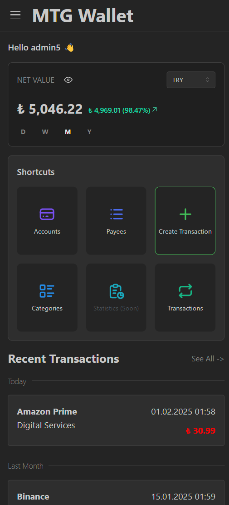
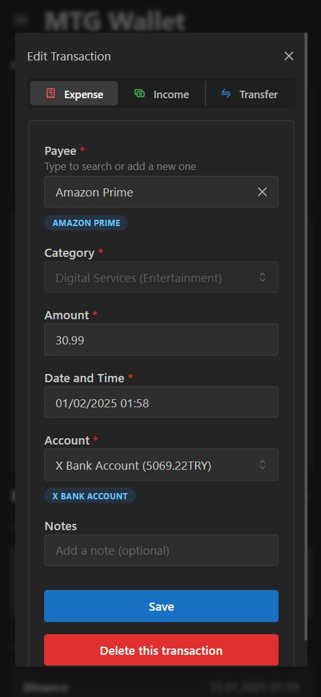
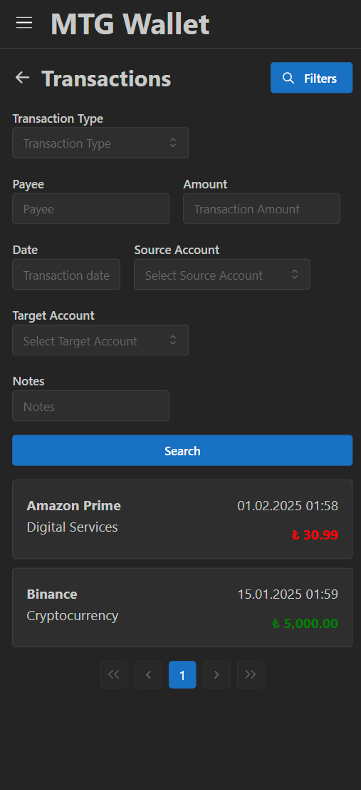
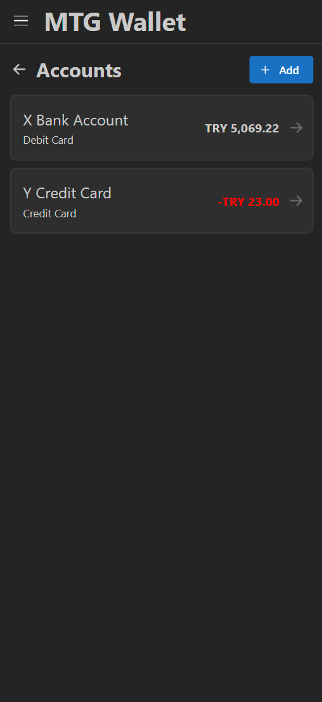

# MTG Wallet FE

[](https://mtgwallet.onrender.com)

MTG Wallet FE is frontend application for [MTG Wallet BE](https://github.com/TolgaGolet/mtg-wallet-be) designed to keep
track of your daily transactions, account balances, and much more in the future.

## 🌟 Features

- **Transaction Tracking**: Record, categorize and view transaction history, with filters and quick-pick suggestions
- **Account Balances**: Keep track of your accounts' balances easily
- **Profits and Losses**: See your net value and profit/loss by day, week, month or year
- **Sign-up and Login**: Email verification, password reset and account recovery
- **Two-Factor Authentication (2FA)**: Set up TOTP with a QR code and sign in with an authenticator app
- **Sessions Across Tabs**: Logging in or out in one tab updates the others
- **Responsive Design:** Designed to be compatible on mobile devices with Mantine

Security, rate limiting, auditing and logging are handled by the backend; see [MTG Wallet BE](https://github.com/TolgaGolet/mtg-wallet-be).

## 🚀 Live Demo

Live demo at: https://mtgwallet.onrender.com

## 📸 Screenshots






## 🛠️ Technology Stack

- **React 18** with **react-router 7**
- **Mantine 7** (UI components, forms, dates, notifications)
- **Vite** (dev server and build) and **Vitest** + **React Testing Library** (tests)
- **ESLint** and **Prettier**; JSDoc types checked with `tsc` (`npm run typecheck`)

## 🚦 Getting Started

### Prerequisites

- Node.js 22.12 or newer, with npm
- A running [MTG Wallet BE](https://github.com/TolgaGolet/mtg-wallet-be) (locally on `http://localhost:8080/api/`)

### Configuration

1. Copy `.env.example` to `.env` (`cp .env.example .env`) and adjust the values for local use. `.env` is gitignored; production values come from the hosting provider's environment settings. Every `VITE_*` value is built into the browser bundle, so never put secrets there.

### Run

```bash
npm install          # install dependencies
npm start            # dev server on http://localhost:3000 (the backend's CORS allowlist expects this port)
```

### Check

```bash
npm test             # Vitest in watch mode (npm test -- --run for a single run)
npm run lint         # ESLint, must report 0 warnings
npm run typecheck    # JSDoc types in files marked // @ts-check
npm run format:check # Prettier
npm run build        # production build into build/
```
